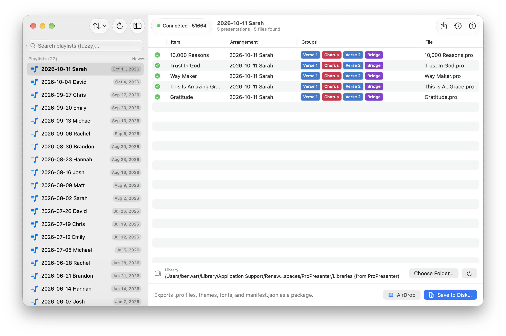
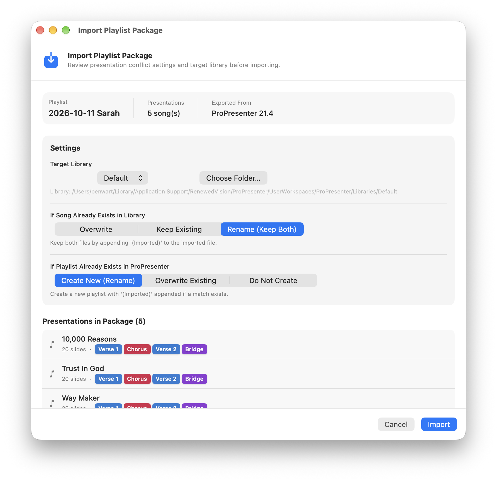
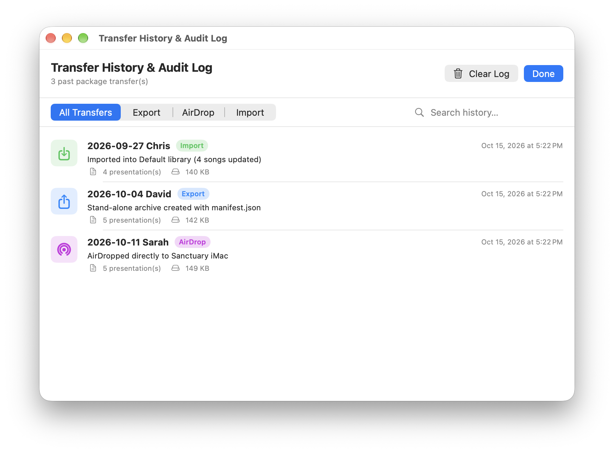
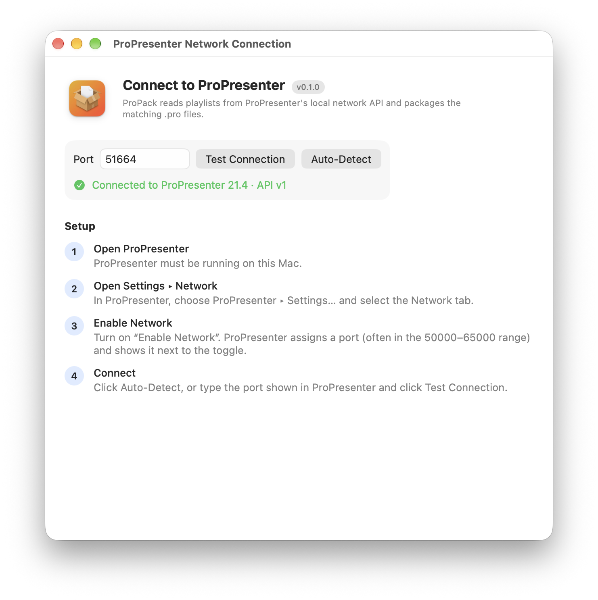
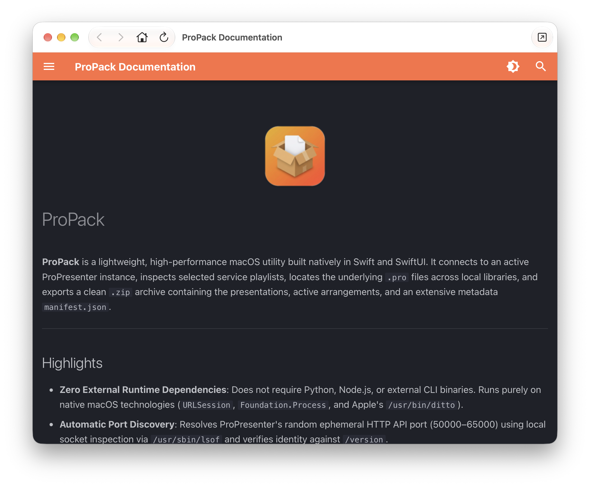

<p align="center">
  
</p>

<h1 align="center">ProPack</h1>
<p align="center"><strong>ProPresenter Playlist Packager, Exporter & Importer for macOS</strong></p>

<p align="center">
  
  
  
  
</p>

---

**ProPack** is a lightweight, high-performance native macOS utility built with Swift and SwiftUI that connects directly to an active **ProPresenter** instance. It inspects scheduled service playlists, resolves source `.pro` presentation files across local libraries, inspects arrangements and slide groups, and exports self-contained `.propack` packages containing presentations, referenced themes, custom fonts, media, and a complete cryptographic `manifest.json`.

ProPack also features a full **Import Engine** with granular conflict resolution policies, an automated **Transfer History & Audit Log**, zero-configuration ephemeral port detection, direct **AirDrop** distribution, and an integrated offline documentation viewer.

<p align="center">
  
</p>

---

## Visual Tour & Key Features

### 1. Playlist Packaging & Slide Group Inspection


- **Hierarchical Playlist Management**: Automatically sorts Sunday service playlists by date (`YYYY-MM-DD {worship leader}`) or alphabetical order, with real-time fuzzy search filtering.
- **Color-Coded Slide Group Badges**: Displays slide groups as vibrant rounded pills mimicking ProPresenter's Arrangement editor styling:
  - <span style="color:#2563EB">■</span> **Verse**: Royal Blue (`#2563EB`)
  - <span style="color:#DC2626">■</span> **Chorus**: Crimson Red (`#DC2626`)
  - <span style="color:#7C3AED">■</span> **Bridge**: Purple / Violet (`#7C3AED`)
  - <span style="color:#EA580C">■</span> **Pre-Chorus**: Orange (`#EA580C`)
  - <span style="color:#0891B2">■</span> **Intro / Interlude**: Cyan (`#0891B2`) / Teal (`#0D9488`)
  - <span style="color:#1E3A8A">■</span> **Outro / Ending**: Navy (`#1E3A8A`) / Charcoal (`#374151`)
  - <span style="color:#7B828D">■</span> **Other / Custom**: Medium Neutral Gray (`#7B828D`)
- **Service Arrangement Mapping**: Detects and displays active arrangements matching each specific playlist (e.g. `2026-10-11 Sarah`, `2026-10-04 David`), seamlessly distinguishing between custom service arrangements and default master presentations.
- **Zero-Config File Matching**: Seamlessly resolves presentation UUIDs to `.pro` files in ProPresenter libraries via direct API paths, multi-library filename heuristics, and binary UUID inspection.
- **One-Click Distribution**: Save packages to disk (`Cmd + E`) or broadcast directly to booth Macs via **AirDrop** (`Cmd + Shift + A`).

---

### 2. Package Import & Intelligent Conflict Resolution


- **Drag-and-Drop Ingestion**: Drop any `.propack` or `.zip` archive onto ProPack or press `Cmd + I` to open the package inspector.
- **Target Library Selection**: Direct incoming presentations to any configured ProPresenter library (`Default`, `Youth`, `Special Events`) or select custom workspace folders.
- **Granular Presentation Conflict Policies**:
  - **Rename (Keep Both)**: Preserves existing songs and appends `(Imported)` or numeric increments to the newly imported files.
  - **Overwrite**: Updates existing `.pro` files in place while preserving ProPresenter's internal index.
  - **Keep Existing**: Skips files that already exist in the target library.
- **Playlist Collision Handling**: Choose whether to create a new unique playlist, update an existing playlist's item order, or import only presentations without altering playlists.
- **Pre-Import Verification**: Inspect total slide counts, presentation groups, source ProPresenter version, and export timestamps before committing changes.

---

### 3. Transfer History & Audit Logging


- **Comprehensive Audit Trail**: Automatically tracks every export, import, and AirDrop transfer in persistent local storage.
- **Transaction Metadata**: Records playlist names, presentation counts, archive file sizes, local file paths, transfer statuses (Completed, Failed), and timestamps.
- **Filtering & Search**: Quickly filter records by transfer category (`All Transfers`, `Export`, `AirDrop`, `Import`) or search history using fuzzy text matching.
- **Safety & Cleanup**: One-click log clearing with verification to maintain clean production records.

---

### 4. Zero-Config Port Discovery & Diagnostics


- **Dynamic Ephemeral Port Detection**: ProPresenter randomly assigns listening ports between `50000–65000` when networking is enabled. ProPack automatically discovers active ports in milliseconds using native socket inspection (`lsof`).
- **Live Health Diagnostics**: Verifies ProPresenter API reachability against `/version` and `/v1/status/stage`, displaying active version details (e.g. `Connected to ProPresenter 21.4 · API v1`).
- **Manual Override & Persistence**: Manually specify ports with `@AppStorage` persistence across app restarts.
- **Step-by-Step Setup Guide**: Built-in instructions guide operators through enabling network control in ProPresenter Settings.

---

### 5. Built-in Offline Documentation Viewer


- **Native Help Window (`Cmd + ?`)**: Browse the complete ProPack user manual, architecture guide, manifest specifications, and troubleshooting steps offline.
- **Bundled Documentation**: Uses an integrated WebKit rendering engine that works completely without an internet connection in isolated production booths.
- **Navigation Controls**: Includes forward/backward navigation, home button, and external browser handoff.

---

## Package Structure (`.propack`)

A `.propack` file is a standard PKZip archive created using Apple's native `/usr/bin/ditto` containing:

```
2026-10-11 Sarah.propack/
├── manifest.json                  # Cryptographic index & playlist metadata
├── Presentations/                 # Source ProPresenter binary presentations (.pro)
│   ├── 10,000 Reasons.pro
│   ├── Trust In God.pro
│   ├── Way Maker.pro
│   ├── This Is Amazing Grace.pro
│   └── Gratitude.pro
├── Themes/                        # Audience Look & presentation themes
│   └── Default/
│       └── Theme.proTheme
└── Fonts/                         # Custom font assets referenced by slides
```

### Sample `manifest.json`
```json
{
  "manifest_version": 1,
  "generated_at": "2026-10-15T23:55:00Z",
  "generator": "ProPack 0.1.0",
  "host": {
    "propresenter_version": "21.4",
    "api_version": "v1"
  },
  "playlist": {
    "uuid": "0DF5F5E2-92E9-437E-AFC4-56C21C2C019B",
    "name": "2026-10-11 Sarah"
  },
  "items": [
    {
      "index": 0,
      "name": "10,000 Reasons",
      "type": "presentation",
      "uuid": "A1B2C3D4-E5F6-7890-ABCD-EF1234567890",
      "arrangement": {
        "uuid": "DEF01234-5678-9ABC-DEF0-123456789ABC",
        "name": "2026-10-11 Sarah"
      },
      "slide_groups": [
        "Verse 1",
        "Chorus",
        "Verse 2",
        "Bridge"
      ],
      "slide_count": 20,
      "relative_path": "Presentations/10,000 Reasons.pro",
      "sha256": "e3b0c44298fc1c149afbf4c8996fb92427ae41e4649b934ca495991b7852b855",
      "size_bytes": 148920,
      "match_method": "filePath"
    }
  ]
}
```

---

## Project Architecture

```
propack/
├── Config/
│   ├── Info.plist                 # ATS local HTTP configuration & document types
│   └── ProPack.entitlements       # Hardened runtime & socket inspection entitlements
├── ProPack/
│   ├── ProPackApp.swift           # Application entry point, window scenes & menus
│   ├── AppModel.swift             # Central observable state machine (Observation framework)
│   ├── ContentView.swift          # Main UI: navigation split view, presentation table, export bar
│   ├── ProPresenterClient.swift   # URLSession REST client & tolerant Codable models
│   ├── PortDetector.swift         # Ephemeral port scanner using native lsof inspection
│   ├── LibraryLocator.swift       # Multi-tiered .pro file resolver across libraries
│   ├── ThemeAndFontLocator.swift  # Discovers Audience Looks, themes, and font assets
│   ├── ExportService.swift        # Staging directory packager, manifest builder & ditto archiver
│   ├── ImportService.swift        # Package decompression, conflict resolution & library writer
│   ├── TransferHistoryStore.swift # Persistent JSON-backed transfer audit log
│   ├── TransferHistoryView.swift  # SwiftUI sheet for auditing past imports/exports
│   ├── HelpWindowView.swift       # Embedded WebKit documentation viewer
│   ├── GroupColorResolver.swift   # ProPresenter arrangement color resolver & badge views
│   ├── ScreenshotCapture.swift    # Headless in-process screenshot capture engine
│   └── LayoutPreferences.swift    # Persistent window geometry and column preferences
├── Tests/                         # Automated unit & integration test suite (32 tests)
└── scripts/
    ├── build-app.sh               # Standalone compilation without Xcode GUI
    ├── create-dmg.sh              # Installer disk image generator
    └── run-tests.sh               # Fast CLI test runner
```

---

## Building & Running

### Requirements
- **macOS**: 14.0 (Sonoma) or 15.0+ (Sequoia)
- **Compiler**: Swift 5.9+ / Swift 6 (Command Line Tools or Xcode 16+)

### Terminal Build (Fast, No Xcode GUI Required)
```bash
# Compile and build dist/ProPack.app
make app

# Run unit test suite (32 tests)
make test

# Launch ProPack immediately
make run

# Install directly to /Applications
make install

# Build compressed DMG installer
make dmg
```

---

## Keyboard Shortcuts

| Shortcut | Action | Description |
|---|---|---|
| `Cmd + E` | **Export Package** | Export the selected playlist to a `.propack` archive |
| `Cmd + Shift + A` | **AirDrop Package** | Export and open macOS AirDrop sharing sheet |
| `Cmd + I` | **Import Package** | Open the `.propack` package importer |
| `Cmd + ?` | **ProPack Help** | Open the built-in offline documentation window |
| `Cmd + ,` | **Settings** | Open ProPack preferences & connection configuration |

---

## License

ProPack is released under the **MIT License**.
