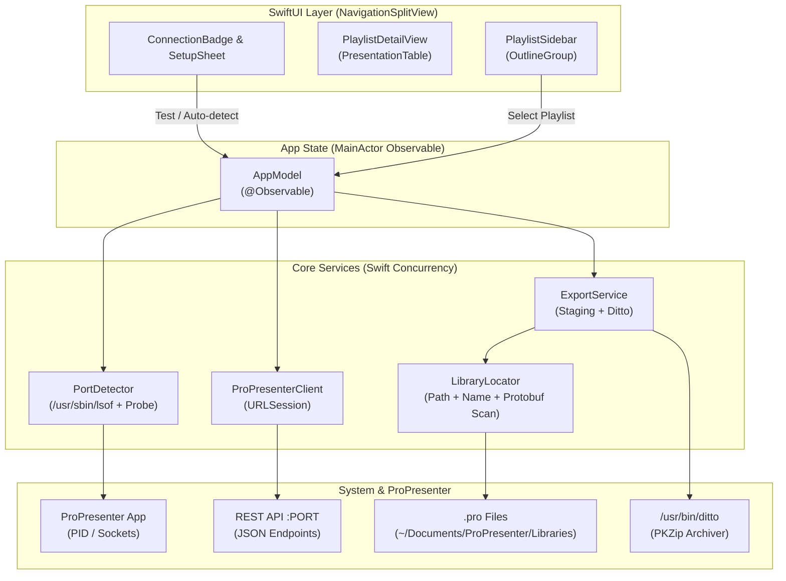

# Architecture & Workflow

ProPack connects the disconnected realms of ProPresenter's REST API and macOS filesystem storage without requiring any background servers, Node runtimes, or Python daemons.

---

## High-Level Architecture

---

## Pipeline Execution Phases

When a user selects a playlist and exports it, the operation executes in two distinct phases:

### Phase 1: Preparation (`ExportService.prepare`)

1. **Playlist Metadata Extraction**:
   Requests `GET /v1/playlist/{id}` to gather all item UUIDs, names, types (presentation, header, cue), and arrangement identifiers.
2. **Concurrent Presentation Introspection**:
   In parallel batches (up to 4 concurrent tasks), ProPack requests `GET /v1/presentation/{uuid}` for every unique presentation in the playlist. This extracts:
   - Slide groups and color data
   - Slide notes and text labels
   - Active `presentation_path` (absolute path on disk)
3. **Library Path Discovery**:
   The first valid `presentation_path` informs ProPack of the active library's root directory.
4. **File Resolution (`LibraryLocator.resolve`)**:
   Locates `.pro` files across detected roots using a tiered matching algorithm to guarantee file integrity.

### Phase 2: Staging & Archiving (`ExportService.export`)

1. **Unique File Copying**:
   Copies every unique source `.pro` file into a temporary staging folder (`/private/tmp/ProPack-<UUID>/<PlaylistName>/Presentations/`). Presentations used multiple times (e.g. with different arrangements) are only copied once.
2. **Checksum & Fingerprinting**:
   Calculates SHA-256 hashes and file size in bytes for each file.
3. **Manifest Serialization**:
   Generates `manifest.json` at the root of the package directory with snake_case keys and ISO-8601 timestamps.
4. **Compression (`ditto`)**:
   Spawns `/usr/bin/ditto -c -k --sequesterRsrc --keepParent <stagingDir> <output.zip>` via `ProcessRunner`.
5. **Cleanup**:
   Deletes temporary staging directories atomically on completion or failure.
