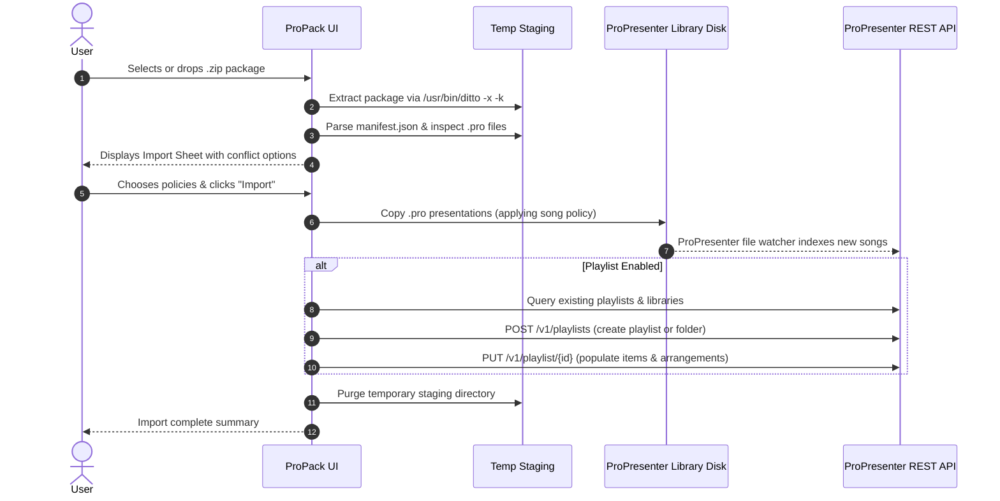

# Technical Specification: Import Pipeline & Conflict Resolution

ProPack enables importing exported `.zip` packages directly into local ProPresenter installations, allowing seamless playlist and presentation portability between machines without manual file management.

---

## Import Architecture Overview

---

## 1. Package Extraction & Manifest Inspection

When a user selects a `.zip` package (via **File ▸ Import Package…**, the toolbar button, or drag-and-drop):
1. ProPack creates an isolated sandbox directory in `FileManager.default.temporaryDirectory/ProPack/ImportStaging/<UUID>/`.
2. ProPack invokes macOS's `/usr/bin/ditto -x -k` to extract the package while preserving resource forks.
3. ProPack recursively locates `manifest.json` and parses it into `Manifest`.
4. It correlates each presentation item in `manifest.items` with its extracted file in `Presentations/`, extracting slide counts and group labels for the UI preview.

---

## 2. Conflict Resolution Policies

ProPack provides fine-grained control over how collisions with existing local files and playlists are resolved.

### A. Presentation / Song File Policies

| Policy | Behavior |
|---|---|
| **Rename (Keep Both)** *(Default)* | If a `.pro` file already exists in the target library, the imported file is renamed to `<Song Name> (Imported).pro` (or `<Song Name> (Imported 2).pro`). Both versions are preserved. |
| **Overwrite** | Replaces any existing `.pro` presentation file in the target library folder with the incoming version from the package. |
| **Keep Existing** | Preserves the local `.pro` presentation file on disk and skips copying the package version. The existing presentation is linked in the playlist. |

### B. Playlist Policies

| Policy | Behavior |
|---|---|
| **Create New (Rename)** *(Default)* | If a playlist with the same name already exists in ProPresenter, a new playlist named `<Playlist Name> (Imported)` is created via `POST /v1/playlists`. |
| **Overwrite Existing** | Overwrites the items of the matching existing playlist using `PUT /v1/playlist/{id}` with the imported playlist sequence. |
| **Do Not Create** | Imports the presentation files into the library on disk, but does not modify or create any playlist in ProPresenter. |

### C. Playlist Group / Folder Policies

| Policy | Behavior |
|---|---|
| **Use Existing Group** | Places the imported playlist inside a matching existing group/folder in ProPresenter. |
| **Create New Group** | Creates a new folder (e.g. `<Group Name> (Imported)`) via `POST /v1/playlists` with `"type": "group"`. |
| **No Group (Root)** | Places the playlist at the root level of the playlists tree. |

---

## 3. ProPresenter Library & API Synchronization

1. **Target Library Selection**:
   The user can select which local library to import into (e.g. `Default`, `Youth`, or any custom directory). ProPack automatically enumerates libraries from `GET /v1/libraries` and well-known library roots.
2. **File Watcher Indexing**:
   When `.pro` files are placed into a library directory, ProPresenter's native file watcher detects the additions and assigns internal UUIDs. ProPack syncs with `GET /v1/library/{id}` to ensure playlist items match the active presentation IDs.
3. **Playlist Creation & Item Injection**:
   - Creates the playlist via `POST /v1/playlists`.
   - Sends the complete items payload (presentations, arrangements, headers) via `PUT /v1/playlist/{id}`.

---

## 4. Staging Isolation & Zero-Cruft Guarantee

- All temporary unzipped files are stored in `FileManager.default.temporaryDirectory/ProPack/ImportStaging/<UUID>/`.
- The staging directory is unlinked automatically via `defer` when import finishes or when cancelled.
- `ImportService.purgeAllStagingDirectories()` runs on application startup to ensure no orphaned files persist across restarts.

---

## 5. Return AirDrop & Custom File Association (`.propack`)

To enable transferring packages back to a Mac and having macOS automatically route the transfer to ProPack:

### Why a Custom Extension is Required
- Generic `.zip` files are claimed by macOS `Archive Utility` and deposited into `~/Downloads` without notifying third-party apps.
- By registering a dedicated Uniform Type Identifier (`com.benwart.propack.package`) bound to `.propack`:
  - macOS recognizes `ProPack.app` as the registered owner.
  - When a `.propack` file is received via AirDrop, macOS prompts to open with ProPack or launches it directly.
  - Double-clicking any `.propack` file in Finder immediately opens the ProPack Import Sheet.

### File Format Compatibility
- Internally, a `.propack` package **is** a standard PKZip archive containing `manifest.json` and `Presentations/`.
- Renaming between `.propack` and `.zip` works transparently with any standard zip utility.
- ProPack supports exporting, AirDropping, and importing both `.propack` and `.zip` files.
