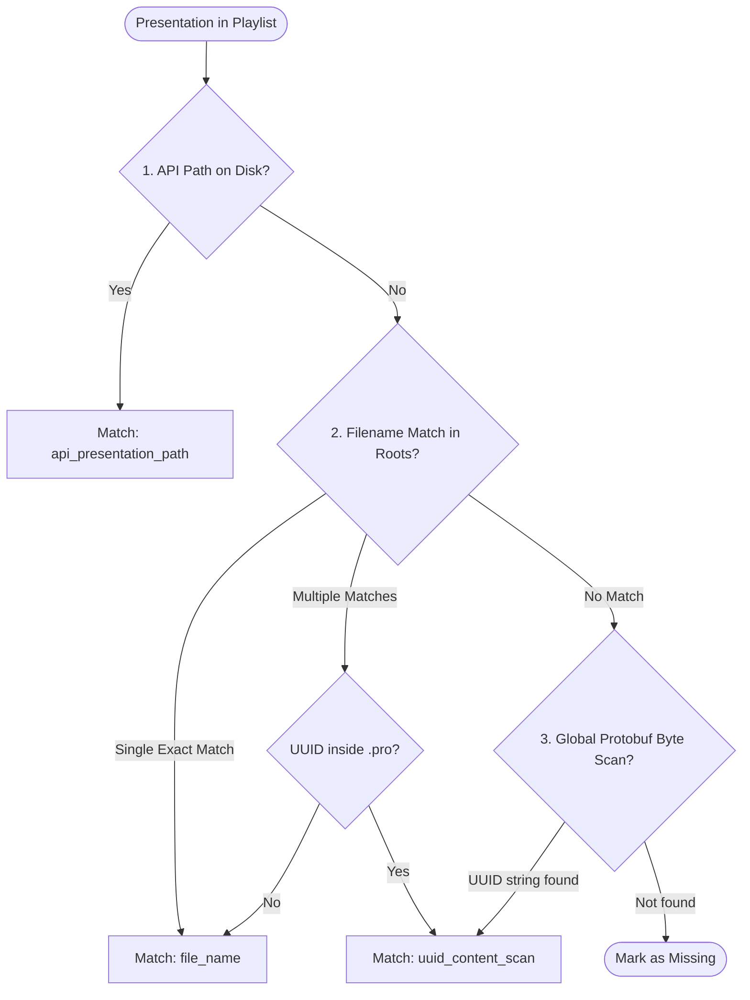

# Technical Specification: Library Discovery & File Matching

ProPresenter's REST API exposes metadata, but does not provide binary file streams for presentations. ProPack bridges this gap by locating the actual `.pro` files stored on the local filesystem.

---

## Default Library Paths

ProPresenter documents are typically organized under the following standard filesystem locations:

1. `~/Documents/ProPresenter/Libraries/` (Default for modern ProPresenter 7 installations)
2. `~/Library/Application Support/RenewedVision/ProPresenter/Libraries/` (Legacy or alternate App Support installations)

---

## Dynamic Library Discovery

When ProPack queries `GET /v1/presentation/{uuid}`, ProPresenter includes the absolute path where the file is currently loaded:

```json
{
  "presentation": {
    "id": { "uuid": "...", "name": "Living Hope" },
    "presentation_path": "/Users/username/Documents/ProPresenter/Libraries/Default/Living Hope.pro"
  }
}
```

`LibraryLocator.libraryRoot(forAPIPath:)` parses this path and climbs up the directory hierarchy until it encounters the enclosing `Libraries` folder. This discovered directory is automatically prepended to the search list.

---

## Tiered Matching Algorithm

Presentations in a playlist may point to moved files, renamed files, or custom library configurations. To ensure complete matching without false positives, `LibraryLocator.resolve` implements a 3-tiered resolution sequence:



### 1. Direct API Path (`api_presentation_path`)
Checks if `presentation_path` from ProPresenter's REST payload directly exists and is readable via `FileManager.default.isReadableFile(atPath:)`.

### 2. Case-Insensitive Filename Matching (`file_name`)
Scans all `.pro` files under registered library roots. Matches files where `fileName.pro` equals the playlist presentation title. If multiple files share the same name, a targeted content inspection resolves the correct file.

### 3. Protobuf Byte-Level UUID Scan (`uuid_content_scan`)
ProPresenter `.pro` files use Google Protocol Buffers internally. Presentation UUIDs are embedded in the message payload as plain ASCII/UTF-8 strings.

If a file has been renamed on disk (e.g., `Living Hope - Easter 2026.pro` vs `Living Hope`), ProPack reads candidate `.pro` files with memory-mapped I/O (`Data(contentsOf: url, options: .mappedIfSafe)`) and tests for the byte sequence of the presentation UUID (testing both uppercase and lowercase representations):

```swift
private static func dataContains(uuid: String, in data: Data) -> Bool {
    for variant in Set([uuid.uppercased(), uuid.lowercased()]) {
        if data.range(of: Data(variant.utf8)) != nil {
            return true
        }
    }
    return false
}
```

---

## Security-Scoped User Selection Fallback

If files reside on an external volume, custom path, or outside standard user folders, users can select a directory using `NSOpenPanel`.

ProPack saves a **security-scoped bookmark** to `UserDefaults`. On subsequent application launches, ProPack restores and activates the security bookmark (`startAccessingSecurityScopedResource()`), maintaining access across app restarts.
