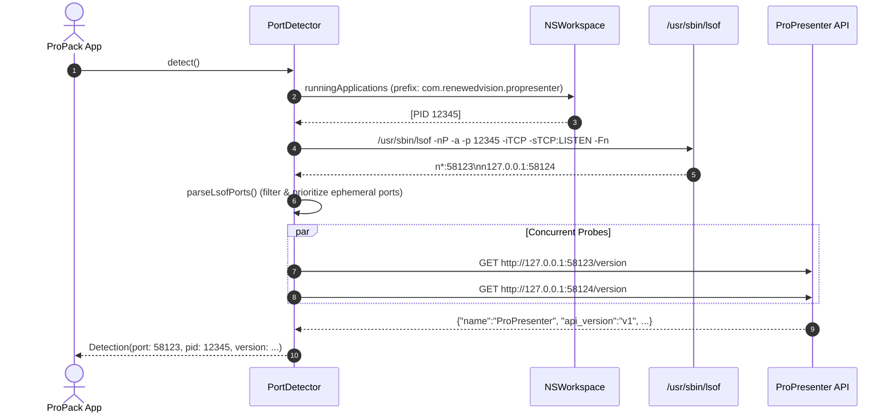

# Technical Specification: Port Detection

ProPresenter does not bind to a standardized port (such as 80 or 8080). Instead, Renewed Vision assigns a dynamic ephemeral port upon installation, usually in the range of `50000` to `65535`.

`PortDetector` automates finding this port without requiring user intervention.

---

## Detection Sequence



---

## 1. Process Discovery & Helper Daemon Inspection

In modern ProPresenter releases, Renewed Vision delegates its HTTP network listener to a dedicated helper process:
`ProPresenter Helper (Network)` (or similar background processes) rather than the main GUI process.

`PortDetector` handles this with a dual-discovery strategy:
1. **Direct command-name inspection via `lsof`**:
   ```bash
   /usr/sbin/lsof -nP -a -c ProPresenter -c "ProPresenter Helper" -iTCP -sTCP:LISTEN -Fn
   ```
   This immediately identifies sockets owned by either the main application or any background network helper daemons.
2. **PID matching fallback**:
   Queries both `NSWorkspace.shared.runningApplications` and `pgrep -i propresenter` to collect all parent and child process IDs.

---

## 2. Listening Socket Inspection & Verification

Once candidate ports are extracted:

- `-nP`: Disables network hostname and service port lookups (critical for speed).
- `-a`: Combines selection criteria with logical AND.
- `-p <PID>`: Scopes inspection strictly to ProPresenter's process.
- `-iTCP -sTCP:LISTEN`: Filters strictly for TCP sockets in the `LISTEN` state.
- `-Fn`: Machine-readable output format. Outputs lines starting with `n`, such as `n127.0.0.1:58123`.

### Parser Logic

The parser extracts the port integer and prioritizes the RFC 6056 ephemeral port range (`49152...65535`):

```swift
static func parseLsofPorts(_ output: String) -> [Int] {
    var seen = Set<Int>()
    var ports: [Int] = []
    for line in output.split(whereSeparator: \.isNewline) where line.hasPrefix("n") {
        guard let colon = line.lastIndex(of: ":"),
              let port = Int(line[line.index(after: colon)...]),
              seen.insert(port).inserted else { continue }
        ports.append(port)
    }
    return ports.sorted { a, b in
        let aEphemeral = ephemeralRange.contains(a)
        let bEphemeral = ephemeralRange.contains(b)
        return aEphemeral != bEphemeral ? aEphemeral : a < b
    }
}
```

---

## 3. Concurrent API Probing

A process may listen on multiple local ports (e.g. internal IPC or remote control sockets). ProPack launches concurrent lightweight HTTP probes (`probeTimeout = 1.5s`) using a Swift `TaskGroup`:

```swift
func probe(ports: [Int]) async -> (Int, PPVersion)? {
    await withTaskGroup(of: (Int, PPVersion)?.self) { group in
        for port in ports {
            group.addTask {
                let client = ProPresenterClient(port: port, timeout: 1.5)
                guard let version = try? await client.version(), version.looksLikeProPresenter else {
                    return nil
                }
                return (port, version)
            }
        }
        for await result in group {
            if let result {
                group.cancelAll()
                return result
            }
        }
        return nil
    }
}
```

As soon as any port returns a JSON payload containing an `api_version` or a `host_description` referencing ProPresenter, the search immediately cancels remaining tasks and resolves the port.
